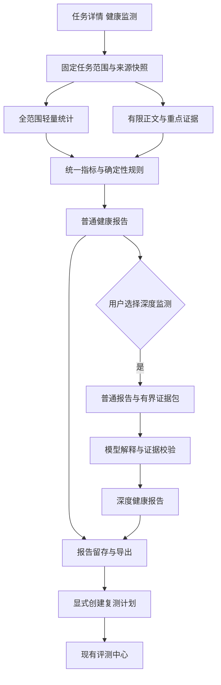

# Telemetry 任务健康监测与性能评测实施方案

日期：2026 年 10 月 30 日  
状态：方案草案，本轮只新增本文档，不修改功能代码  
适用项目：awesomeTelemetry，当前分支 codex/agent-architecture-r4，分析基点 1a6876a

## 1 建议做成什么

建议在任务详情中增加一个「健康监测」入口，提供「普通监测」和「深度监测」，分别生成可保存、可导出、可追溯的报告。两者共享同一份任务快照、指标口径和证据引用。

**普通监测负责把事实算清楚，深度监测负责解释可能的原因，并提出值得验证的优化方案。** 普通监测完全在本地运行，不调用大模型；深度监测在普通报告之上调用已配置的模型。深度分析失败不影响普通报告。

这套能力应同时回答五个实际问题：

1. 这次任务的时间主要花在哪里，哪些等待值得优先调查？
2. 是否存在重复安装、失败重试、上下文膨胀、批量不足、交接阻塞等现象？
3. 用户什么时候收到反馈、看到有效信息、拿到可用结果？
4. 每条结论依据哪条记录，哪些判断还缺数据？
5. 下一步改什么，用什么固定任务和验收标准确认改善？

实现时复用现有任务工作台、证据诊断和评测中心。新增的核心是统一指标语义、全任务统计、体验数据接入、双报告和模型解释层。健康监测分析已有过程，复测由评测中心另行显式启动。

## 2 对文章的理解

### 2.1 专项的核心是把慢拆成可定位的问题

文章把“太慢”拆成四种现象：客观执行耗时、长时间没有反馈、有效价值出现太晚、主线信息过多。这一点非常适合成为 telemetry 的分析主线。仅展示 Token、工具次数和总耗时，解释不了用户为什么觉得慢。

文章的案例说明：首次响应只有 2 秒，不代表用户很快获得帮助；根因到约 120 秒才出现、首个可审阅组件约 480 秒才出现，才是影响使用体验的关键。应同时记录“接住任务”“给出有效判断”“产物可以审阅”“产物通过验证”这些不同的时刻。[A，开篇与第 3 章]

### 2.2 五个优化维度转成五类诊断

| 文章维度 | telemetry 应回答的问题 | 建议对应的优化实验 |
| --- | --- | --- |
| 体感快 | 首次反馈、有效信息、产物出现是否太晚？最长无反馈多久？ | 有效信息前置、渐进交付、状态反馈、日志折叠 |
| 规划快 | 决策是否绕路？是否反复探索和返工？拆分是否合适？ | 调整规划与提示词、减少无效决策、改变任务边界 |
| 单点快 | 哪个工具、命令或依赖步骤最慢？可否复用或批量执行？ | 目录预检、依赖复用、结果缓存、批量操作 |
| 模型快 | 首 Token、后续生成、上下文和缓存分别表现如何？ | 稳定前缀、上下文治理、thinking 策略、模型路由 |
| 启动快 | 接收任务到第一项有效工作之间发生了什么？ | 启动接口并行、进程复用、索引与状态缓存 |

“感 → 少 → 并 → 快”可作为建议组织顺序；具体优先级仍应依据这次任务的关键路径、证据强度、质量风险和改造成本。不能无论任务是什么，都固定建议换模型、减少思考或增加并行。

### 2.3 最值得保留的测评办法

- 使用固定任务集，按 L1 修复、L2 功能实现、L3 完整应用分层，并保留后端、前端等题型。
- 固定任务、起始代码、模型和验收标准，重复执行；每题 3 次适合第一轮筛查。
- 总耗时与轮次、模型、工具、缓存、体验联合解释。
- 既观察均值，也保留逐次结果、分位数、失败和超时，防止长尾被平均数掩盖。
- 每项措施都回到原任务和原口径复测，验证“局部优化是否传导到端到端”。

文章中“工具单次更快，但任务整体更慢”和“轮数更少，但端到端仍落后”尤其重要：**单项指标改善不自动等于任务改善。** telemetry 不应按单一指标给产品排总榜。[A，第 4 章与 5.3]

## 3 融入前需要校正的口径

文章提供了很好的诊断方向，但其中部分数字、简化公式和因果判断不能直接固化成规则。

| 文章中的表述或现象 | 实施时的处理 |
| --- | --- |
| 16.0 分钟相对 10.7 分钟“慢 33%” | 以 10.7 为基准，慢约 49.5%；从 16.0 降到 10.7，才是缩短约 33.1%。报告明确基准和分母 |
| 28.63 → 18.75 分钟 | 降幅约 34.5%，可四舍五入为 35%；仅支持同一 v1 口径比较 |
| 串行根方程 Σ模型时间 + Σ工具时间 + 排队 | 用作分析框架。多 Agent、模型与工具重叠时，必须改用时间区间并集和显式依赖图 |
| 模型累计时间达到 E2E 的 114% | 在计数正确时说明累计工作时间存在重叠的可能；单凭比例不能证明无轮间空窗，也不能证明工具并行 |
| 剩余时间都解释成排队或空转 | 未被已知活动覆盖的时间先称“未归因间隔”。可能是用户等待、网络、调度、丢失日志等 |
| TTFT 等同 Prefill，差异归因于 thinking | 首 Token 的观测层和内容类型必须一致；客户端 TTFT 可能含网络、排队和首段生成，不能直接当纯 Prefill。参见 [NVIDIA 指标定义](https://docs.nvidia.com/aiperf/reference/ai-perf-metrics-reference) |
| MaaS TTFT 字段单位为秒，示例又乘 1000 | 接入时核实原字段单位，内部统一毫秒，保留原值与换算版本，禁止凭字段名猜单位 |
| TPOT 分母使用 output_tokens − thought_tokens | 先核对输出是否已包含思考，以及时间窗口是否与分母对应；不能机械减掉思考 Token |
| 缓存命中 Token 占“总 Token” | 新报告统一为命中输入 Token / 总输入 Token；输入是否包含缓存必须由来源明确声明 |
| 同模型证明差距只来自编排 | 还需固定端点、模型实际版本、参数、缓存状态、工具、环境和质量；同一模型名并不足够 |
| 少轮数、并行必然更快 | 必须考虑依赖、竞争、交接和返工。减少必要验证可能更快却更差 |
| 无思考 Token 就是关闭 thinking | “显式关闭 thinking”与“明确报告思考量为零”分开统计；缺失计数不等于零，零计数也不单独证明配置关闭 |
| 反馈可使主观等待固定减少 30% 至 40% | 不据此输出“体感耗时”。用可见事件和人工体验评测衡量，公式只作解释性类比 |
| 利特尔定律可直接推出某负载下的 P95 排队倍数 | 平均量关系本身不足以给出尾分布；没有实际队列事件时不生成排队预测 |
| frontend 约 70 → 35.5 分钟的总结措辞 | 这是该题 E2E 的描述，不作为工具时间降幅；文章局部措辞和表格须分开核对 |

文章给出的产品数据保留为该次专项的自述结果，不作为 telemetry 内置的跨产品性能基线。尤其不把 95% 缓存、56% 无思考、100 秒工具时长当成所有任务通用的合格线。

## 4 现有项目能复用什么

以下结论依据当前实现，不仅依据说明文档。文末列出主要代码入口。

| 现有能力 | 可以复用的部分 | 需要补齐的部分 |
| --- | --- | --- |
| 任务工作台 | 任务及成员、主子 Agent 关系、分页快照、原始记录定位 | 明确全任务和局部范围；新的运行起止边界 |
| 任务过程结构 | 原生 round、attempt、tool 引用及歧义状态 | 分开统计用户轮、决策轮、逻辑模型调用、网络尝试 |
| 会话诊断 | 10 条本地规则和事件定位 | 校正时长、覆盖度和弱推断，不能直接改名为健康报告 |
| 架构诊断 | 上下文膨胀、工具冲突、交接引用缺口；证据、阈值、复验建议 | 扩充性能规则；补全任务统计，保留原有架构分析能力 |
| 抓包诊断 | 同一观测时钟的首字节、首内容、完成时间、重复请求线索 | 与任务及逻辑调用准确关联；不能替代产品 UI 可见时间 |
| Team 指标 | 区间并集、并发、明确阻塞、完整 DAG 的关键路径算法 | 在任务健康层满足身份、时钟和依赖条件后复用 |
| Benchmark | 固定任务、独立验收、重复执行、实测 span、Token 语义、均值与 P95 | 固定任务集、体验事件、分层汇总、优化前后报告关联 |
| 报告导出 | 现有 HTML、Markdown、JSON 等导出实现经验 | 新增普通与深度报告、版本留存、统一证据引用 |

### 4.1 三个必须先解决的问题

**第一，旧 scan 指标不能直接换名字。** 当前 scan TTFT 是首条用户输入到首条 LLM 日志开始的时间差；TPOT 是有效 LLM 日志时长之和除以输出 Token。它们并非真实流式首 Token 或 Decode TPOT。旧 E2E 在多事件场景主要是首末事件开始时间差，也不必然等于用户提交到完成。[C1]

**第二，现有诊断是有界取证。** 架构诊断最多读 400 条原生元数据、64 条正文、8 个捕获和 32 个逻辑调用。适合提出有证据的局部发现，不能拿这部分样本计算“整个任务”的总调用数、平均耗时和健康通过率。[C3]

**第三，深度分析还没有通用服务。** 当前设置主要管理日志来源；现有 Anthropic 客户端属于任务模式实验，真实调用走显式 CLI。它不等于浏览器已经支持深度健康监测。需要独立的模型配置、分析执行和报告保存契约。[C7]

另外，CodeArts 目前实际复用 OpenCode 适配器；MaaS、InferHub、Kernel 三层 TTFT/TPOT 没有完整落地，不能因注释出现这些名称就宣称已有。旧 START-HERE 中 cacheRead 用 max 的说明已过期，当前权威契约和实现采用逐步增量 sum。[C8]

### 4.2 旧规则如何收敛

新报告不直接采用下面这些强结论：

- 首轮之后所有 input 的占比，不能证明“系统提示词重复”。
- 事件时长求和的占比，不能标成并行任务的 E2E 占比。
- 没有 verify 事件，只能按覆盖情况说明“未观察到”或“证据不足”。
- 四次用户输入不等于四次被迫纠偏。
- 先写后读不自动等于盲写，新建文件和已在上下文中提供内容都可能合理。
- 一条规则可产生多个发现，不能用“规则总数减发现条数”算通过项或健康分。

保留这些规则的排查价值，用精确来源、适用条件和中性措辞重新表达。[C2]

## 5 用户如何使用

### 5.1 入口与范围

在任务标题附近放置「健康监测」按钮，打开后选择：

| 模式 | 操作说明 | 产出 |
| --- | --- | --- |
| 普通监测 | 本地分析，无模型费用 | 普通健康报告 |
| 深度监测 | 使用已配置模型，显示证据范围和分析预算 | 普通健康报告，以及关联的深度健康报告 |

默认范围建议为“整个任务，包含已确认归属的子 Agent”。用户也可主动选择“仅主 Agent”“指定成员”或“指定时间段”，报告标题同步标明范围。

当前任务页默认成员是 main，架构诊断接口仅接受任务与成员，不接受时间窗。新功能必须明确传递选定范围，不能让用户看到的时间筛选与实际分析范围不同。搜索关键词、折叠状态和当前页码不应悄悄改变全任务监测的分母。[C4]

没有明确关联的子会话列为“归属待确认”，不能通过标题相近或时间接近自动拼接。一个长会话内多次用户请求也不能自动当作一次标准测试任务；优先使用明确 run 边界，必要时让用户选择分析轮次或时间段。

限定时间段时，墙钟分布只计算活动区间与窗口的交集，完整任务 E2E 保持原定义；局部报告写“窗口时长”。调用数区分窗口内开始和窗口内活跃，调用平均耗时只使用完整有效的调用并公开分母。没有 Token 级时间戳时，不按时间比例摊分 usage；跨窗口调用单列，不能冒充窗口精确 Token 或费用。

### 5.2 一次点击后的流程

1. 固定任务成员、时间范围、各来源记录版本和序列上界，形成任务快照。
2. 检查数据是否已解析、时间与 Token 口径是否可用，列出缺失项。
3. 在后台分批读取轻量数据，完成全范围统计；再读取异常附近的有限证据。
4. 运行规则，立即生成普通报告。状态显示“准备数据 → 计算指标 → 检查问题 → 报告完成”。
5. 若选深度监测，把普通报告和有界证据交给模型；状态增加“解释原因”。
6. 保存两份报告及关联关系，提供查看、定位原记录、导出和基于建议创建复测计划的入口。

未解析的数据不通过打开页面暗中触发全量扫描。普通操作路径先说明缺口，提供明确的“准备本任务数据”动作；准备完成后再分析。

任务运行中也可监测，但报告标为“截至某时刻的快照”，不给最终 E2E 或最终成功结论。来源改变后旧报告保留为历史，当前页提示“已有新数据”，重新运行才产生新报告。

## 6 指标数据如何分层

每项指标需要同时保存：数值、单位、起止边界、作用域、来源层、采集方式、覆盖度、有效样本数、证据引用和计算版本。下面是拟新增的语义要求，具体字段须先写入 OpenSpec，再实施。

| 层次 | 含义 | 示例 |
| --- | --- | --- |
| 实测 | 有准确边界、明确语义和来源的测量 | 工具实际开始与结束、模型首个内容 Token、UI 首次呈现 |
| 观测 | 在某一位置观察到的时间或现象 | 代理收到首内容、原生日志出现某记录 |
| 推导 | 从观测确定性计算或估算 | 相邻日志间隔、区间重叠、同输入哈希的重复次数 |
| 语义推断 | 由规则启发式或模型解释 | 某次探索可能无效、某个结果可能已经可用 |
| 不可用 | 数据缺失、语义不明或覆盖不满足 | 未采集渲染事件的真实 TTFR |

这些层次与“覆盖完整、部分覆盖、无法确认覆盖”独立记录。实测了 10 个调用，不等于整个任务的调用都被实测。没有命中规则，也不等于任务健康。

当前 durationSource 主要是会话级声明，不能证明其中每个事件都实测；新层需要逐项保留时间来源。数值未知、里程碑尚未发生、不适用和真实零值分别表示；无效或负时间差列为数据问题，不能强行钳成零掩盖时钟错误。

时间存储保留 UTC 时间和同进程单调时钟偏移。跨主机或跨层比较需要共同请求 ID、时钟来源和同步误差；不能直接相减不同机器的绝对时间。新报告保留原始值，不回写成看似准确的旧指标。

## 7 文章指标如何完整映射

### 7.1 体验指标

这些指标描述的是被评测代码智能体的界面，而不是 telemetry 自己的报告界面。仅给 telemetry 页面增加埋点，不能测出 CodeArts 或 Trae 当时让用户等了多久。

| 指标 | 新报告口径 | 普通监测条件 | 深度监测增加什么 |
| --- | --- | --- | --- |
| TTFR 首次反馈 | 任务提交到首个明确可见的接收或状态反馈 | 原产品渲染事件或录屏标注 | 解释反馈是否只是形式回应 |
| TTFMP 首个有效信息 | 任务提交到第一条能支持用户判断的信息 | 经人工确认的价值标记，或满足固定标准的结构化事件 | 从可见内容中找候选，给理由与反例，标为模型判定 |
| TTV 可用结果 | 任务提交到首个符合预设交付标准、可审阅或可运行的产物 | 产物身份、出现时间、可访问状态和验收口径 | 判断产物是否切题、是否只是占位 |
| max_gap 最大反馈空窗 | 活跃任务区间内，连续两次新增有效可见反馈之间的最长间隔 | 完整可见事件流，含首段和尾段空窗 | 识别刷状态但没有实质推进的情况 |
| volume 信息负担 | 默认主线可见字符数、块数、日志占比、展开层级等分别呈现 | 渲染/可见性信息；字符口径固定 | 分析冗长、重复和结果被过程掩盖 |
| TTD 任务完成耗时 | 提交到真实终态对用户可见 | 提交与终态事件 | 检查完成说明与产物、验证证据是否一致 |

TTV 再分别展示“首个可审阅产物”和“首个通过约定验证的产物”，避免把首次文件写入当成已完成交付。不同任务的“有效信息”采用预先约定的标准：修 bug 可以是有依据的根因定位，做功能可以是可审阅的关键 diff。

可见反馈必须有内容或状态变化。常驻旋转图标、重复“处理中”心跳不能反复重置实质进展空窗。可同时显示“任意可见反馈空窗”和“实质进展空窗”，后者依赖结构化价值事件或语义判定，避免用刷消息改善指标。

只有日志时，可以提供“首条输出日志”“首个 diff 记录”“日志最长无新增”等代理指标，并注明其边界。不能填进真实 UI 体验指标。没有录屏、渲染埋点或对应可见时间戳时，深度模型也无法补出真实 TTFR、TTV。

### 7.2 工程与模型指标

| 文章字段 | 单任务报告中的对应项 | 计算与限制 |
| --- | --- | --- |
| avg_n2e_duration_s | 本次运行 E2E | 单次是一个值，跨运行才取均值；保留原始秒数 |
| toolCallCountAvg | 工具实际执行次数 | 按明确调用身份去重，不能把调用记录和结果记录各算一次 |
| singleToolAvgDuration | 单工具平均耗时 | 同口径执行耗时总和 / 有效执行数，另列 P50/P95/max |
| singleTaskToolTotalDuration | 工具累计工作时间 | 所有有效工具执行耗时相加；同时给占用时间并集 |
| modelCallCount | 逻辑模型调用次数 | 与决策轮、网络重试、日志条数分开 |
| singleModelInferAvgDuration | 模型调用平均耗时 | 按层与语义分别算；网络请求时间不标成纯推理 |
| singleTaskModelTotalDuration | 模型累计工作时间 | 求和可超过 E2E；另列并集及关键路径证据 |
| cacheHitRate | 输入缓存命中率 | Σ命中输入 / Σ规范化总输入，保留来源包含关系 |
| maasTtft | MaaS 首 Token 延迟 | 来源真实请求与首 Token 字段，核实单位和内容类型 |
| inferhubTtft | InferHub 首 Token 延迟 | 对应层的 span 与首 Token 字段 |
| kernelTtft | Kernel 首 Token 延迟 | 对应层的 span 与首 Token 字段 |
| maasTpot | MaaS 续 Token 耗时 | 原生指标保留原公式；标准化值另算 |
| inferhubTpot | InferHub 续 Token 耗时 | 时间窗口与输出/思考 Token 语义匹配 |
| kernelTpot | Kernel 续 Token 耗时 | 与其他层分列，禁止无依据混合平均 |

三层数据用同一逻辑调用和明确请求映射关联，缺哪层就显示哪层缺失。嵌套 span 不累计计费、不重复计为多次模型调用。只有同一请求、相同首内容定义、可对齐时钟和边界时，才讨论层间额外耗时；“两层平均 TTFT 相减”不能直接算网关开销。

模型时长统计进一步区分“逻辑调用完成时间”和“实际尝试工作量”：同一逻辑调用发生三次尝试，逻辑次数可以是 1，尝试次数为 3。尝试平均耗时用有效尝试数作分母，不能把三次尝试总耗时除以逻辑调用数后仍标成单次请求耗时。

### 7.3 为定位问题补充的指标

| 类别 | 补充指标 |
| --- | --- |
| 规划 | 用户交互轮、编排决策轮、逻辑模型调用、传输尝试；失败后修复链；首次实现前探索量 |
| 工具 | 工具类别分布、长命令、安装/构建/测试时长、重复命令候选、实际修改文件数 |
| 批量与并行 | 每次决策的工具调用数、每次调用修改文件数、同时活跃工具数、并行时间占比 |
| 子 Agent | 委派启动延迟、执行重叠、主流程等待、交接往返、父子关键依赖 |
| 上下文 | 每次请求的输入 Token、增长趋势、重复完整分块、工具目录规模、压缩事件 |
| 模型策略 | 实际模型与端点、明确的 thinking 模式、已报告思考量、不同任务角色的模型分布 |
| 启动 | 提交到初始化、初始化到可执行、进程启动、索引和配置读取；无事件时保持未知 |
| 质量与稳定性 | 工具结果、超时、取消、明确重试、验收通过/失败/未知、恢复是否成功 |
| 成本 | 规范化输入、输出、思考、缓存读写；只有价格和计费语义明确时才给估算费用 |

并行率与批量率分开。一轮批量写入多个文件，即使没有并行，也可能减少决策轮数。反过来，工具同时运行但争用依赖、修改同一文件，可能增加返工。

## 8 关键计算规则

### 8.1 总耗时与时间构成

任务完整起止存在时，E2E = 完成时间 − 提交时间。准备、Agent 执行、外部验收分别计时；代码智能体执行过程中自己安装依赖属于执行时间，不能挪到准备阶段来美化结果。

交互任务另外保留明确的“等待用户”区间，展示 E2E 和扣除已知用户等待后的活动区间。没有明确暂停/请求输入事件时，不凭两次用户消息之间的间隔猜用户等待。

模型和工具分别保留两种数值：

- 累计工作时间：每次有效执行时长求和，用于理解工作量。
- 墙钟占用时间：同类有效区间的并集，用于理解实际占用了多少时间。

时间构成图采用互斥分区：仅模型、仅工具、模型与工具重叠、其他已观测活动、未归因区间。等待用户如与活动重叠则单独标注，不能双重扣减或与其他分区重复相加。

例如两项工具分别执行 10 秒、8 秒，并且同时开始，累计工作量是 18 秒，墙钟占用是 10 秒。不能说“工具占 18 秒，所以 E2E 至少 18 秒”。只有完整依赖和执行证据才能计算关键路径；资料不足时只展示实际重叠与候选瓶颈。

### 8.2 首 Token 与续 Token

每个调用区分请求开始、首字节、首个非空内容、首个非思考输出、最后内容、请求完成。HTTP 首字节、空 SSE 事件、工具参数、思考 Token 和用户可见文本不能混为一个终点。

标准化 TPOT 候选口径为：

    Σ有效调用的后续内容生成窗口 / Σ对应窗口内的后续 Token 数

若只有总输出量，且采用“首块相当于一个 Token”的约定，可使用 Σ(最后内容时间 − 首内容时间) / Σ(输出 Token − 1)，明确标注该约定和客户端观测属性。有精确首块 Token 数时使用对应数量；分母为零、思考范围不匹配或末尾只剩协议收尾时，不输出伪精确值。首块数量与后续窗口的区别参见 [NVIDIA AIPerf 指标说明](https://docs.nvidia.com/aiperf/reference/ai-perf-metrics-reference)。

现有 Benchmark 使用 Σ(duration − firstToken) / Σ(output − 1)，可复用其计算组织与有效性校验，但新来源需确认 duration 是否到最后内容、是否含收尾，以及 output 是否覆盖同一生成窗口。必要时保留“原生 TPOT”和“标准化观测 TPOT”两列，通过计算版本区分，不能静默改旧报告。

没有实际 Prefill/Decode span 时，不把 TTFT 和 TPOT 改名为硬件推理阶段耗时。

### 8.3 Token 与缓存

按明确逻辑调用及其实际尝试身份选择规范来源。原生日志与抓包记录同一次实际尝试时去重；不同尝试的已报告 usage、费用和耗时分别保留，不能因属于同一逻辑调用就合并消耗。失败或超时的尝试也可能产生消耗，未返回 usage 时标未知，不能当零。身份无法对齐时按来源并列，不猜测一个汇总数。

使用输入是否含缓存、输出是否含思考的声明去重；累计 usage 只有在同一流、重置规则明确时才能差分。

缓存命中率的分母是规范化总输入。某来源 input 已含 cacheRead，就不能再加；不含时按其语义补齐。未报告 cacheWrite 不普遍等于零，只有明确“不报告且按既定规则处理”的来源才可依既有契约计算。包含关系未知时保留各原始计数，修正总量和命中率显示不可用。

报告可以分析稳定前缀、重复内容和缓存失效线索，但“内容重复”不等于“缓存一定可命中”，也不等于这些内容应该删掉。

## 9 普通监测具体能发现什么

普通监测执行纯计算和规则，使用预先写好的解释模板。每条规则有适用条件、阈值、事实、证据、限制和复测建议，不需要大模型写报告。

| 规则方向 | 能客观指出的现象 | 下一步建议与限制 |
| --- | --- | --- |
| 数据不完整 | 任务成员未加载、缺调用身份、时间来源不明、来源已变化 | 优先补证据；不发全任务健康结论 |
| 长工具调用 | 实测工具超过配置阈值，按名称和类别列 Top 项 | 先区分安装、构建、网络、测试；慢不自动等于卡死 |
| 重复依赖准备 | 同目录、同参数、同依赖指纹出现多次安装 | 核对环境重置和必要性，再试依赖复用 |
| 工具失败与重试 | 明确错误码、实际失败结果、有关联的重试链 | 修复环境、参数或契约；重复文本不等于重试 |
| 重复读取或查询 | 目标、参数及内容版本相同的重复调用 | 检查缓存或上下文保留；文件变化后的重读不算冗余 |
| 写入批量不足 | 多轮每轮只改一个文件，批次规模偏小 | 列候选合并操作；存在依赖时不建议强行并行 |
| 可并行任务串行 | 明确独立依赖节点实际串行 | 给出候选调度实验；没有依赖信息只描述执行顺序 |
| 模型首内容慢 | 相同测量层的有效调用超过阈值或基线 | 检查输入、缓存、服务与网络，暂不认定 Prefill 根因 |
| 续 Token 慢 | 同口径 TPOT 偏高或流式长停顿 | 同时看输出长度、思考量和内容类型 |
| 缓存命中偏低 | 可比输入语义下的命中率低 | 区分冷启动、不可缓存输入与稳定前缀失效 |
| 上下文增长与重复 | 同流至少多个有效请求的输入明显增长、完整分块重复 | 复用现有架构诊断；不因增长直接判定无用 |
| thinking 与模型分配 | 显式配置在所有可见调用中相同、辅助任务也走同端点 | 描述分布；是否过度思考由后续语义分析和实验判断 |
| 委派与交接等待 | 明确 spawn、接收、返回和 blocked 关系 | 看关键路径与独立性；子 Agent 多不等于低效 |
| 反馈与价值后置 | 有可见事件时发现长空窗、产物出现晚 | 无可见事件时只给日志代理指标 |
| 启动阻塞 | 已记录初始化链路存在串行等待或重复进程启动 | 针对具体初始化步骤复测，不用未知空窗顶替 |
| 质量与收尾 | 独立验收失败、缺失，或有验证结果却缺产物入口 | 质量结论依赖验收；“执行过 tsc”不等于功能正确 |
| 返工候选链 | 编辑、验证失败、再编辑在同目标上连续发生 | 展示关联事件；必要测试修复不自动计为浪费 |

阈值采用“任务类型基线 + 可调筛查阈值”。例如工具 100 秒可作为对齐文章的长调用筛查档，TTFT 5 秒可沿用现有 Benchmark 的初始提示，二者均不是自动判定卡死或应终止的标准。缓存 95% 仅作文章对标参考，不设全局红线。

优先级分开表达：验收失败先提示质量问题；性能发现按关键路径影响证据、绝对等待量、重复频度和可实施性排序。证据不足不能靠提高严重等级补偿。

首版建议不用一个总健康分。展示“发现问题”“覆盖范围内未观察到”“证据不足”“不适用”，并给出各类检查的可判断数量。完整覆盖内未观察到异常，也只针对当前规则集。

## 10 深度监测如何让模型参与

### 10.1 模型负责的分析

模型阅读任务目标、普通报告和选定的过程证据，补充以下判断：

- 探索是否围绕任务目标，是否在简单任务上启动了过重流程。
- 重复安装、搜索、读取、修改是否有合理的环境或需求变化原因。
- 多轮错误是否具有同一根因，而不是多个独立问题。
- 拆分、交接和验证是否安排在合适的位置。
- 哪些操作可能合并，哪些看起来独立但实际共享状态。
- 首个“有效信息”候选是否真的帮助用户做判断，产物是否已经可审阅。
- 简单推进是否可能使用更轻的模型或 thinking 策略，应该如何验证质量不下降。

输出采用“候选解释 → 支持证据 → 反证或替代解释 → 建议改动 → 复测方法”。语义结论标为模型判断，不升级成实测事实。

### 10.2 模型接收的材料

使用同一个快照中的普通报告和有限证据包：任务目标、重要时间点、慢调用、失败链、上下文变化前后样本、关键交接和最终产物/验收摘要。选择既包含异常，也包含相邻正常样本，避免只给异常材料导致归因偏差。

证据包带原始记录 ID、字段路径、时间、截断与覆盖说明。完整指标由确定性计算提供，模型不能改写它们。若材料被截断，不能据“没看到”断言不存在。

模型不读取任意本地文件、不执行命令、不调用业务工具，也不自动更改 Agent 提示词或配置。日志正文按待分析数据处理，正文里的指令不改变分析任务。分析输入中屏蔽认证信息，只发送完成此诊断所需的片段。

### 10.3 输出检查与失败处理

模型返回结构化结果。服务检查证据 ID 是否属于本次快照、数值是否来自普通报告、结论是否缺少依据；无效引用和新编造的数字不进入正式发现。

保留模型提出但尚未验证的假设。涉及收益时，优先给“可能缩短哪个等待区间”和实验目标。只有依赖图完整、假设明确时才允许提供理论上界，并列出无法重叠的部分；不把所有慢工具时长相加作为可节省时间。

深度分析记录模型实际标识、提示词版本、输入证据摘要哈希、分析耗时、Token 用量和运行状态。诊断本身的模型消耗单独列出，不回灌为被监测任务的性能或成本。

配置一次分析模型和预算后，由用户点击深度监测发起；首版单次请求、有界输入与输出、超时可取消、不自动重试扣费。没有配置时普通监测仍可使用。失败、取消和超时有独立状态，普通报告始终保留。

## 11 两份报告长什么样

### 11.1 普通健康报告

建议报告顺序：

1. **本次结论**：优先看的 3 至 5 项问题、数据覆盖和验收状态。
2. **任务范围**：任务、运行、成员、时间窗口、快照和来源版本。
3. **性能与体验指标**：已测值、代理值、不可用项分别呈现。
4. **时间构成**：累计工作量、墙钟占用、真实重叠和未归因间隔。
5. **五类诊断**：每项问题的事实、证据、适用条件、建议和复测办法。
6. **质量与缺口**：独立验收、未覆盖来源、需要补采的事件。
7. **计算依据**：指标版本、规则版本、本次阈值和有效样本数。

下面是格式示例，所有数值均为虚构演示，不代表当前项目实测：

> 任务运行耗时 600 秒。已解析 3/3 个已确认成员；24/24 个逻辑模型调用和 48/48 个工具执行有完整身份，模型与工具区间均有有效时间。
>
> 墙钟分布：仅模型 250 秒、仅工具 150 秒、两者重叠 100 秒、明确等待用户且无其他活动 40 秒、未归因 60 秒。模型累计工作量 420 秒，工具累计工作量 300 秒；这些累计值不用于相减计算空窗。
>
> 发现：同一目录、依赖指纹未变的安装调用出现 3 次，累计 120 秒，见示例证据 tool-07、tool-19、tool-33。是否可以省略其中某次，仍需检查环境状态。
>
> UI 体验：未采集产品可见事件，TTFR、TTFMP、TTV 和最大反馈空窗不可用。
>
> 质量：独立验收通过 20/20；60 秒未归因间隔仍需补充事件，不能标为模型排队。

### 11.2 深度健康报告

深度报告独立保存，并引用普通报告版本：

1. **最值得验证的原因**：最多 3 至 5 条，避免重复普通指标。
2. **过程解释**：用户目标、关键决策和可能浪费的步骤。
3. **证据链**：支持、反对与缺失证据，点击可回到原记录。
4. **优化建议**：前置条件、改动范围、预期影响和质量风险。
5. **复测方案**：固定任务、控制变量、主要指标与验收条件。
6. **分析记录**：模型、版本、输入范围、费用或用量、运行状态。

同样使用虚构案例，示例发现可以写成：

> 候选原因：依赖准备可能没有跨步骤复用。依据是 3 次安装的工作目录和依赖指纹一致，第一次已返回成功；现有记录未显示为什么又需要准备依赖。
>
> 替代解释：工作区曾被重新创建，或安装结果未保留；现有证据不能排除。
>
> 建议：补充环境复用标识，实验中先做依赖就绪检查，只在失效时安装。
>
> 验证：固定同一任务与验收器，比较安装次数、安装墙钟占用、E2E 和验收结果。不能承诺节省全部 120 秒，因为部分安装可能必要或与其他活动重叠。

### 11.3 保存与导出

每份报告有独立 ID、生成时间和版本。普通与深度报告共享快照 ID，深度报告还绑定所引用的普通报告及证据包摘要。相同快照与配置可复用已完成的普通报告；更改阈值、模型或证据范围后生成新版本。

首版提供 HTML 阅读版和 JSON 结构化版；Markdown 可作为协作文档导出。普通与深度分别下载，也可一起导出。静态 HTML 转义证据及模型输出，不依赖远程脚本；本地证据跳转在原环境可用，离线阅读保留引用和摘要。默认导出不包含原始完整会话和认证信息。

建议报告正文先使用应用管理的独立文件、原子写入和轻量索引，沿用项目现有文件型报告经验，不把原始正文塞进主 SQLite 表。目录、上限、清理方式、版本和导入校验须先形成契约；不默认删除历史原始证据。

原证据删除或重新绑定后，历史报告保留当时范围和分析状态；当前证据跳转重新检查存在性与归属，失效时显示“原证据不可访问”，不能从报告缓存恢复被删除的原文。报告内摘要副本和深度输入包的保留、联动清理范围须单独约定；用户已导出到外部的文件不宣称可以自动撤回。

## 12 普通与深度分析的实现结构

### 12.1 全范围统计与重点取证分开

全范围统计在后台分批读取已解析的轻量元数据，不依赖 UI 当前 200 条记录；不逐成员从浏览器发请求，不读取全部正文。身份去重、区间计算和覆盖度都基于固定快照完成。

重点取证复用现有 collector 的身份检查、来源完整性、取消和前后版本校验。现有 400 条元数据、64 条正文等限制继续适用于该取证路径；新全范围统计需要独立预算，不能悄悄放宽原诊断上限。

新取证入口应支持按全范围统计得到的准确事件 ID 定点读取，沿用至多 64 条正文等限制。当前 collector 从任务前 400 条元数据选证据，不能直接满足后半段异常取证；新报告必须能定位第 2,000 条记录附近的问题，而不是再次只取开头样本。

初始预算建议为每次最多 100 个已确认成员、20,000 条轻量记录、分批 200 条；这是待测试的新方案上限，不是当前实现能力。超过上限时报告明确部分覆盖，允许缩小范围或后续扩展后台聚合，不能截断后标完整。身份总数、实测时间、usage、体验事件分别报告覆盖。

普通分析复用现有单任务执行与取消模式，重计算放后台，可分批让出执行线程。报告摘要优先展示，证据详情按需加载。深度模型请求与普通分析有各自截止时间和资源预算，均不阻塞任务列表与采集转发。

普通与深度报告使用新增的显式创建分析接口，旧 GET 架构诊断接口继续只读且不调用模型，不能加一个 deep 参数就绕过其原有契约。新接口需定义请求去重、执行状态、显式结果查询、断连取消和文件写入失败；刷新页面不重复启动模型，取消不删除已完成的普通报告，保存失败不显示“已保存”。状态更新使用合并通知或用户显式读取，不引入轮询。

### 12.2 需要接入的数据

优先建立“某来源某指标是否可测”的能力表，以实际采集路径和版本为准：

| 来源 | 可提供的核心数据 | 不能据此自动获得的数据 |
| --- | --- | --- |
| 已有原生会话 | 任务/工具/消息身份、状态、部分 usage 和实际 span | 完整模型首 Token、原界面渲染时间 |
| HTTP 或 WS 捕获 | 请求响应、同钟网络时序、逻辑调用、部分原生 usage | 服务内部队列和 Prefill；用户是否已经看到内容 |
| CodeArts session 与 trace | 接入后提供 MaaS、InferHub、Kernel 层字段 | 不能因产品名相同就假设字段完整 |
| 原产品或扩展埋点 | 提交、反馈呈现、产物可见、验证、终态、暂停等待 | “有效”“可用”的语义仍需固定标准 |
| 录屏及人工标注 | 首帧、有效信息、可用产物、可见空窗 | 精确服务端调用时长 |
| 独立 evaluator | 固定验收用例结果和质量报告 | 用户等待体验 |

建议新增的事件语义包括提交、反馈已呈现、有效信息候选、产物可审阅、验证结束、任务终态、等待用户起止、初始化步骤、明确调用依赖。事件携带原任务与调用身份、单调时间或录屏时间基准、来源和可见性；名称和字段在契约阶段统一。

接入先以 CodeArts 为重点，再按来源能力扩展其他产品。历史数据缺少 UI 或三层时间时，只能保留缺口；补采机制只能改善以后任务。

### 12.3 预计涉及的模块

| 模块 | 计划 |
| --- | --- |
| OpenSpec | 新增任务健康监测的指标、报告、来源能力、执行边界与预算契约 |
| src/core | 新增健康指标与规则编排；复用并校正现有 findings、architecture、benchmark 算法 |
| server/storage 与任务服务 | 固定快照、全范围轻量读取、准确成员和调用身份 |
| server 健康分析服务 | 有界取证、普通报告、深度模型分析、取消、版本与保存 |
| TaskWorkbench 与诊断组件 | 健康监测按钮、普通/深度选择、报告展示和证据定位 |
| 设置模块 | 独立分析模型配置与预算，服务端保存凭据引用 |
| adapters 与采集模块 | CodeArts 三层字段、逐测量时间来源、体验事件接入 |
| BenchmarkCenter | 从报告创建复测计划，展示同题前后对比和分层汇总 |

这是修改范围建议，不是本轮代码变更清单。实现前先明确新契约与字段，再落代码；保留已有原始记录、旧报告解释口径和其他实验模块边界。

## 13 把单任务诊断接回性能专项

### 13.1 两类评估分别回答问题

单任务健康报告用于定位“这次发生了什么、值得改哪里”。专项回归评测用于验证“这项改动是否稳定改善，同等质量下是否更快、更省”。单个任务无法证明某产品普遍更快。

首批回归集建议覆盖 L1/L2/L3 和文章暴露的问题：依赖重复准备、前端批量文件实现、后端测试失败修复、长工具、上下文增长、独立子任务与强顺序子任务、UI 价值前置。稳定可重复任务先用于调优，同时保留失败/超时任务组，防止只优化顺利样本。

### 13.2 固定实验条件

在现有 Benchmark 的固定 commit、prompt、evaluator、模型配置之外，记录任务集版本、产品版本、真实模型端点、thinking/采样参数、工具与权限、系统与机器、网络、依赖环境、缓存冷热策略、超时和成功标准。

跨产品比较若无法完全控制，报告写成配置组合对比。原始未知字段保留未知，不因用户填了模型标签就当实际模型已经一致。

改动前后按题配对，沿用交错和轮转执行顺序；外部 GUI、机器负载和共享缓存仍需控制或记录。冷启动和热缓存分组，不能先后顺序不同却把收益全归给改动。

### 13.3 统计口径

- 每题先做 3 次筛查，保存全部结果；现有 runner 支持 1 至 10 次。需要更多重复时合并明确定义的实验批次，或在契约中扩展，不能假设已无限支持。
- 先按同题汇总，再给任务类别与全任务集宏平均；另列按真实业务权重计算的结果。公开权重，避免题目构成变化制造改善。
- E2E 以运行/任务为单位；单次模型和工具指标以对应有效调用为单位。均值的加权方法写清，分位数从原始样本计算，不能平均各组 P95。
- 缓存命中按 Token 加权；TPOT 按对应 Token 间隔加权；同时保留每次运行的分布，不能将不同层或不同来源混算。
- 展示有效样本 n、计划/完成次数、均值、P50、P95、极值和失败。P99 作为后续可选项，3 次运行的高分位几乎只是最大值，不能证明尾延迟稳定。
- 超时记为超时和删失边界，不当成功完成时长；失败、取消、未知都计入相应分母。成功样本速度可单列，但不能隐藏成功率变化。
- 配对差值及不确定性需要足够、可比的重复样本；小样本只给方向，不宣称统计显著。

速度验收同时检查固定功能验收。构建、静态检查、单元测试和浏览器功能验证分别列出；不能为了 E2E 更短而少跑必要验证，也不能让模型自评替代验收器。

### 13.4 优化闭环

每条建议连接一个可保存的复测计划：问题与证据 → 只改的变量 → 主指标 → 质量条件 → 固定任务 → 原始报告与改后报告。

例如“依赖复用”实验的主指标是安装次数及安装墙钟时间，最终看 E2E；“价值前置”实验主要看 TTFMP/TTV 和人工判定一致性；“并行写入”实验同时看决策轮、批量规模、重叠、写冲突和验收；“动态 thinking”实验同时看调用时延、任务成功率和返工。

健康监测按钮只创建分析结果。创建实验计划不等于执行实验，真正重跑仍沿用评测中心的明确执行动作。

## 14 分阶段实施顺序

| 阶段 | 交付物 | 完成条件 |
| --- | --- | --- |
| 第一阶段 口径与样本 | 指标契约、来源能力表、人工标注小样本、旧规则调整清单 | 每个指标有边界/单位/缺失规则；串行、并行和不完整案例可手算验证 |
| 第二阶段 普通监测 | 健康监测入口、全范围轻量统计、首批规则、普通报告与导出 | 不调用模型；每条发现可定位；无数据不报健康；大任务不阻塞阅读 |
| 第三阶段 专项数据接入 | CodeArts 三层时序、体验埋点或录屏标注、运行边界 | 能测的指标实测，测不到的标缺失；字段与原始来源逐项校验 |
| 第四阶段 深度监测 | 分析模型设置、有界证据包、结构化诊断、独立深度报告 | 同快照双报告；引用有效；数值不改写；失败与取消不损坏普通报告 |
| 第五阶段 回归闭环 | L1/L2/L3 固定集、前后对比、分层统计、建议关联复测 | 同题同口径复验；保留失败与质量结果；报告可重复计算 |

第二阶段就能交付实用的无模型监测；第三阶段决定文章中的体验与三层指标能覆盖到什么程度。体验数据规范在第一阶段定义，采集接入可与后续工作并行。深度分析可先支持已有日志的语义问题，不等待所有产品埋点齐全，但必须显示它的可判断范围。

首批优先做数据覆盖、长工具与安装、调用/轮次区分、缓存与上下文、明确失败链、验收状态六类，再扩展依赖图和体验分析。这样能先解决文章中可验证的主要问题，而不会先生成一份看起来完整、实际缺依据的报告。

## 15 验收方法

### 15.1 关键计算与反例

| 验收场景 | 必须得到的结果 |
| --- | --- |
| 两个 10 秒工具完全重叠 | 累计 20 秒、墙钟并集 10 秒；不出现负排队时间 |
| 只有相邻日志，没有实测 span | 可以显示日志间隔，不输出纯模型推理耗时 |
| 首包为空、随后是思考、再出现文本 | 三个时间点不混用；按约定内容类型计算 |
| input 已包含 cacheRead，output 已含 reasoning | 缓存和思考不重复累计 |
| usage 未上报或思考字段缺失 | 显示未知，不变成 0 或“已关闭思考” |
| 同调用同时出现在原生日志和抓包 | 证据互相链接，调用次数与 Token 不翻倍 |
| 一个逻辑调用重试两次，三次均报告实际 usage | 逻辑调用 1 次、尝试 3 次，全部已知消耗保留，不把重试去重掉 |
| 原生请求身份缺失、WS 连接承载多调用 | 保留身份不足；不把连接当一次模型推理 |
| 任务 2,000 条记录，界面只打开 200 条 | 普通统计覆盖完整固定范围，或明确标部分；不冒充全部 |
| 只有主 Agent 已加载 | 子 Agent 未覆盖明确显示，不给整个任务无异常结论 |
| 页面限制时间段 | 分析范围与报告一致；全任务模式不暗中受搜索和页码影响 |
| 工具执行 0 至 20 秒，窗口为 5 至 15 秒 | 窗口占用 10 秒，完整调用时长 20 秒，不把任务 E2E 改成 10 秒 |
| 异常位于任务第 2,000 条记录 | 统计与定位准确，定点取证能获取对应上下文，不只检查前 400 条 |
| 没有 UI 可见事件 | TTFR/TTFMP/TTV 不可用，日志代理指标有独立名称 |
| 用户正常追加需求 4 次 | 记录交互次数，不自动判定被迫纠错 |
| 文件改变后重复读取、环境重置后再安装 | 不确认为无效重复；保留必要性条件 |
| 没有验收来源或只跑了构建 | 验收未知，不给“质量通过” |
| 深度模型编造证据 ID 或改写指标 | 无效内容被拒绝或降为未采纳，普通事实保持一致 |
| 报告保存后原证据被删除或改变归属 | 历史状态保留，当前定位明确失效，不从缓存绕过证据检查 |
| 两个建议共用同一等待区间 | 不重复计算可节省时间 |
| 三次运行中一次超时 | 超时保留；不只展示两次成功来宣称稳定 |

### 15.2 诊断质量

建立人工审阅的小样本集，覆盖文章中的问题类型和上述反例。普通规则分别检查误报、漏报与证据定位；深度分析检查证据支持、替代解释、建议可执行性和是否越过数据边界。

TTFMP/TTV 等语义标注至少用双人复核一批样本，记录分歧及裁定规则。模型版本和提示词变更后用同一批样本回归，不能只看报告文字是否流畅。

### 15.3 产品与性能

页面验收覆盖普通/深度入口、范围选择、进度、取消、失败重试、旧报告、新数据提示、两份导出和精确证据跳转。用真实单 Agent 与多 Agent 任务检查大任务阅读体验。

实施时运行对应单测、集成和浏览器验收，以及项目要求的 typecheck、test、lint、perf:check。普通监测要验证零外部模型请求；深度监测要验证有界输入、单独用量和失败保留。

新模块继续遵守原有 slim/body/raw 分层、无逐行请求、无请求路径同步大文件处理、SSE 合并、事件循环与转发预算。新增预算在契约阶段明确，用实测验收，不豁免已有性能约束。

## 16 主要依据与代码入口

### 文章与指标参考

- [A 用户提供的 CodeArts 阶段性性能优化总结](/Users/penghao/.codex/attachments/01a0adef-251f-42f5-8627-ed6243b04628/已粘贴的文本.txt)，文内日期 2026-10-26。第 2 章提供方法论，第 3 章提供指标与测评口径，第 5 章提供措施和复测数据。
- [B NVIDIA AIPerf 指标说明](https://docs.nvidia.com/aiperf/reference/ai-perf-metrics-reference)，查阅于 2026-10-30，用于核对客户端 TTFT、首个非思考输出、后续 Token 窗口与首块 Token 假设。

### 当前实现与契约

- C1 旧 scan 时间与 Token 算法：[speed-metrics.ts](../src/core/speed-metrics.ts)、[helpers.ts](../src/adapters/helpers.ts)、[metrics-analysis spec](../openspec/specs/metrics-analysis/spec.md)。
- C2 旧会话规则：[session-findings.ts](../src/core/session-findings.ts)，尤其时长求和、sysPromptRepeat、ttft、manyInterventions 与通过数计算。
- C3 架构诊断证据、覆盖度及读取上限：[collector.ts](../server/architecture-diagnosis/collector.ts)、[architecture-diagnosis-types.ts](../src/core/architecture-diagnosis-types.ts)、[architecture-diagnosis contract](../openspec/contracts/architecture-diagnosis.md)。
- C4 任务入口、成员与快照：[TaskWorkbench.tsx](../src/components/task/TaskWorkbench.tsx)、[task-types.ts](../src/core/task-types.ts)、[task-workbench.ts](../server/storage/task-workbench.ts)、[task-process contract](../openspec/contracts/task-process.md)。
- C5 固定任务评测与独立验收：[benchmark-analysis.ts](../src/core/benchmark-analysis.ts)、[benchmark contract](../openspec/contracts/benchmark.md)、[benchmark 使用说明](benchmark.md)。
- C6 并行与抓包证据：[team-metrics.ts](../src/core/team-metrics.ts)、[capture-diagnostics.ts](../src/core/capture-diagnostics.ts)、[trace-types.ts](../src/core/trace-types.ts)。
- C7 当前配置与实验模型客户端：[SettingsModal.tsx](../src/components/SettingsModal.tsx)、[anthropic.ts](../server/agent-folding/anthropic.ts)、[agent-folding-report.ts](../src/core/agent-folding-report.ts)。
- C8 CodeArts 与 Token 语义：[codearts.ts](../src/adapters/codearts.ts)、[opencode.ts](../src/adapters/opencode.ts)、[gotchas G4](../openspec/gotchas.md)。
- C9 开发与性能边界：[AGENTS.md](../AGENTS.md)、[nfr contract](../openspec/contracts/nfr.md)。
