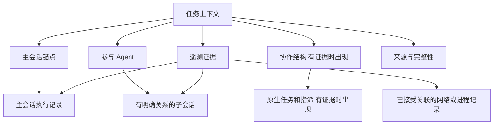
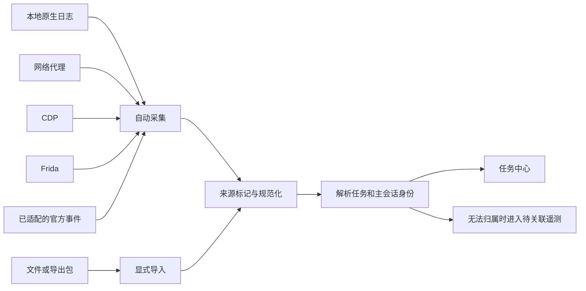
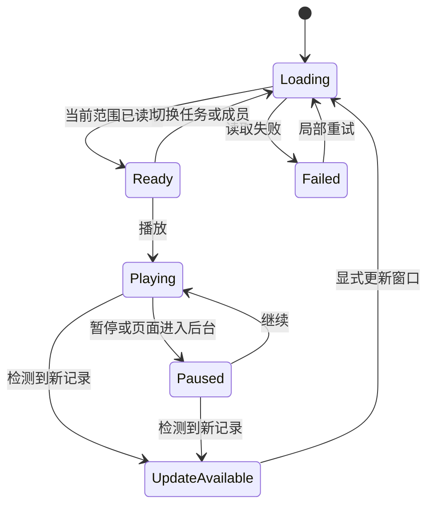
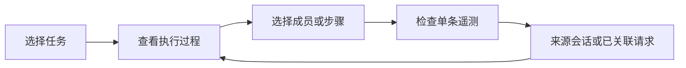
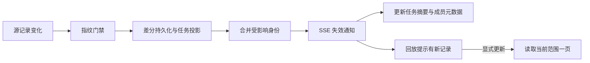

# 以任务为中心的遥测工作台完整设计

日期：2026 年 10 月 25 日。状态：设计基线；任务工作台主流程已实现。实际交付与剩余增强项见 [implementation.md](implementation.md)。

## 一 产品主线

用户关注的是一个正在完成的任务，以及执行它的主会话。主会话可能由一个 Agent 完成，也可能创建、调用或协调其他 Agent。工作台应围绕这个任务组织执行过程和遥测证据。

因此，单 Agent 和多 Agent 是任务的执行结构；本地记录、网络代理、CDP 和 Frida 是获取数据的通道；采集与导入是数据进入本系统的两种方式。这三类概念分别表达对象、结构和来源，不能放在同一层导航中。

核心使用流程是：选择任务，直接阅读执行过程，在需要时展开参与成员，并在同一上下文检查支持某个判断的遥测证据。

参考 DSH 后，任务详情不再以概览页或独立播放器开场。摘要收进任务头部；过程提供对话、执行轨迹、原始事件三种读法，右侧共用单条证据检查器，逐步回放属于过程内操作。源码依据、交互对照和改进理由见 [DSH 参考分析](dsh-reference.md)。

## 二 当前基线和设计边界

### 代码基线

设计时的分支为 `codex/telemetryref-npm-continuation`，已提交基线为 `47a80ba`；实施分支为 `codex/task-observability-workbench`。本机保留默认关闭采集和 Codex 团队持续更新的本地改动，它们需要与本轮界面设计分别管理。

一次现场观察包含 43 个会话与 14 条团队派生记录，一个已展开案例包含 20 个 Agent 和 19 条父子关系。14 条派生记录包含单成员记录，不能直接解读为 14 个已证实的多 Agent 团队。该案例未提供完整任务指派和消息通信证据。

讨论中的 UI 原型已封存在 `.local-runtime/execution-workbench-prototype-20261025/`，实施前前端源文件曾恢复到原有分支状态，随后按正式契约重新实现。原型不作为方案已实施或全流程已通过验证的依据。

### 本轮目标

1. 用户从任务进入调查，而不是先选择某种采集技术或单多 Agent 页面。
2. 同一个任务页面支持主会话和已被证实的子 Agent 关系。
3. 采集与导入明确区分，历史导入不会显示为当前正在运行。
4. 数据接入能解释每种通道何时使用、能获得什么和不能证明什么。
5. 回放范围、查询范围、当前选择和原文证据保持一致。
6. 迁移不丢失原始记录、旧链接和已经存在的关联身份。

### 非本轮目标

不建立完整项目管理系统，不自动生成业务任务 DAG，不自动调度多 Agent，不修改模型或目标工具的权限，不自动安装证书，不在浏览页面时发送模型请求。不恢复仓库已经取消的费用展示；继续保留 Token、缓存和调用等原生观测。

## 三 统一业务对象

### 任务与主会话

第一阶段的“任务”是围绕一个明确主会话组织的用户调查对象。主会话身份作为稳定锚点，相关子会话、参与成员、原生任务记录和网络证据附着到这个上下文中。

这不意味着数据库中的 Session、TeamRun、TeamTask 变成同一种对象。任务详情通过读取投影组合已有对象，保留各自的来源和身份。

一个主会话可以跨多个自然语言轮次。用户改变话题时，不根据模型猜测自动切成多个任务。若用户需要把同一主会话拆为多个业务目标，或把多次独立主会话归到同一需求，应后续增加显式的人工分组能力。

### 名词表

| 名词 | 定义 | 页面中的表达 |
|---|---|---|
| 任务 | 用户要调查的一次工作执行上下文，初期锚定明确主会话 | 任务列表的一行、任务详情 |
| 主会话 | 用户直接发起或明确选择的原生会话 | 任务执行主线 |
| 子会话 | 有明确父子或委派证据的原生会话 | 任务内可展开的参与过程 |
| Agent 实例 | 某次执行中可区分的参与者 | 成员、角色、关系、成员回放 |
| 工具来源 | Codex、CodeAgent、Claude 等工具或适配来源 | 任务来源筛选与接入配置 |
| 团队运行 | 已有的跨 Agent 关系及活动投影 | 支撑任务内协作结构，不作为独立一级产品 |
| 原生协作任务 | 来源中明确存在的任务和指派记录 | 有证据时显示的任务分工 |
| 执行轮次 | 有明确或声明过的边界的会话片段 | 回放步骤与会话阅读 |
| 遥测证据 | 对话、工具事件、请求响应、状态、产物和原始记录 | 任务证据区与单条检查 |

来源中的 `task_started` 可能表示一次执行轮次开始，不必然是业务任务。相同角色、昵称、标题或接近的时间也不代表同一个 Agent、同一个任务或一次通信。

### 任务锚点规则

- 有明确父线程时，子会话归属到能可靠解析的根主会话。
- 没有父关系证据的会话可以独立成为任务，不能只靠名字自动归组。
- 子会话先到、主会话后到时，先保留待归属记录；后续明确关联后更新投影。
- 出现父关系冲突、循环或缺失时显示异常，不随机选择一个成员作为根。
- 旧的会话合并组可能是显示组织方式，不自动等价于原生任务或团队身份。

### 对象关系



没有多 Agent 证据时，任务仍然完整可读，只显示主会话过程。增加子 Agent 不应创建另一个与原任务并列的重复任务行。

## 四 两种进入方式与多种采集通道

### 面向用户的两类来源

**采集记录**是本系统通过已配置通道主动读取、监听或接收的记录，包括启动后补读的本地历史会话。采集时间不等于执行发生时间，也不证明执行当前仍在进行。

**导入记录**是用户通过文件或已有数据包显式带入的记录。它可以来自本机历史、其他机器或别人导出的真实执行；导入身份不说明其真实性、完整性或当前在线状态。

“采集”和“导入”描述进入本系统的过程，不使用“真实”和“模拟”作为这两个入口的替代名称。本机合成自检也可能经过真实代理，因此诊断数据需要独立标记，默认不混入正式任务。

历史记录如果缺少可确定的进入方式，应显示“来源待确认”。这是兼容状态，不代表新增第三条接入流程，也不能强行把旧的 scan 或 proxy 字段映射成真实性认证。

### 来源与通道的关系



导入一个由 Frida 或网络代理产生的文件时，本次进入方式仍为导入；原始采集通道可以作为来源说明保留，但不能把它显示成当前正在运行的 Frida 或代理。

## 五 每种方式何时使用

| 方式 | 优先使用条件 | 通常能够提供 | 主要限制 | 在本项目中的定位 |
|---|---|---|---|---|
| 本地会话记录 | 工具会写入本机可读的会话或事件日志 | 对话、执行轮次、工具调用、原生用量及日志保留的子 Agent 关系 | 不保证包含完整模型请求、网络时序和成员消息 | 观察 Codex、CodeAgent 等任务执行的首选通道，按来源适配器支持范围读取 |
| 网络代理抓包 | 需要核对实际模型请求响应，且目标客户端支持相应代理和信任配置 | HTTP 请求响应、流式内容、声明用量与可观测网络时间 | 不保证知道业务任务、工具实际执行、Agent 委派或完整协作过程 | 补充任务的模型调用证据，通过可靠身份关联 |
| CDP | 浏览器或 Electron 目标已允许调试连接，且流量经过 Chromium 网络栈 | 已支持目标的浏览器网络和调试记录 | 不能覆盖所有桌面应用、原生网络栈或加密通道 | 高级采集；当前仓库的 CDP 路由属于开发模式，不能声称普通生产启动即可使用 |
| Frida | 目标进程已有专门适配，其他通道无法获得所需信息 | 适配脚本可以观察到的进程内数据 | 与平台、进程版本、权限和脚本有关，不能通用支持所有 Agent | 高级目标适配；现有 Trae Windows 相关能力不能视为本机 macOS 或任意 CodeAgent 已验证 |
| 官方事件或 hooks | 工具提供项目已适配的结构化事件接口 | 明确的生命周期、调用或身份事件 | 只覆盖工具实际输出的事件，未适配来源不承诺支持 | 可选补充通道，例如当前已有的 Claude hooks，不推定 Codex 同样支持 |
| 文件导入 | 需要分析历史、其他环境或他人提供的记录 | 文件中实际保留的执行与遥测 | 不会观察后续变化，格式和证据覆盖受限 | 项目已支持的 TraceLog 等格式；不承诺任意 JSON 或 PCAP 均可直接导入 |

### 对当前 Codex 场景的建议

先用本地会话监听获取主线程和子 Agent 执行记录。需要核对模型请求原文、实际响应或网络区间时，再启用网络抓包。缺失的任务指派或通信不能通过打开一个不相关通道自动补全。

CDP 和 Frida 不需要与本地日志、代理同时开启。接入页应根据用户要回答的问题和目标能力给出可用选项，并解释缺口，而不是要求用户理解所有底层技术后才能查看任务。

### 选择路径

```text
我要看 Agent 如何完成任务
  有受支持的本地会话记录 → 本地监听
  有受支持的官方结构化事件 → 可追加该通道

我要核对实际模型请求和响应
  客户端可使用代理 → 网络抓包
  受支持的浏览器调试目标 → 可选 CDP
  仅有专门进程适配能读取 → 可选 Frida

我已经有一份记录
  校验格式和覆盖 → 导入 → 以导入记录查看
```

## 六 信息架构

```text
任务中心
  来源视图 采集记录 / 导入记录
  任务列表
    来源、时间、记录状态、搜索
    多 Agent 标记是属性，不是另一个列表入口
  任务详情
    任务头部摘要
      目标、主会话、来源、记录状态与覆盖
      成员结构与分工 有证据时展开
    执行过程 默认进入
      范围 主会话 / 全任务 / 指定成员
      读法 对话 / 执行轨迹 / 原始事件
      时间图、筛选、分页、逐步回放
    共享证据检查器
      所选记录的输入、输出、时序、原文、来源与关联
    对比 从任务列表选择或详情操作发起

数据接入
  自动采集
    目标工具与数据范围
    本地记录、代理、CDP、Frida、已支持官方事件
    配置、启停、最近接收、解析与持久化结果
  文件导入
    支持格式、导入历史、失败重试
  待关联遥测
    暂无明确任务身份的请求和记录

设置
  语言与显示
  存储、保留与导出策略
  高级兼容能力
```

一级导航只有任务中心、数据接入和设置。复杂聚合统计放在任务中心的可选统计入口；现有 Mission、来源汇总和比较页面通过兼容路由保留，不承担默认首页。

## 七 总览的取舍

对当前以单个任务调查为主的使用方式，独立的多指标总览不是必要入口。任务中心顶部保留可操作的小摘要：正在监控的任务范围、存在新记录的任务、采集失败或来源不可用。

摘要点击后应改变任务筛选或进入对应接入状态。没有后续动作、口径不清晰或缺少证据的统计不占据首屏。

来源汇总回答不同工具的整体使用情况，不等于团队成员列表。它保留在可选统计区域。只有实际需要跨任务观察使用趋势时，才扩展独立分析工作区。

## 八 任务列表设计

### 列表内容

```text
任务中心                              监控已有会话  导入记录
采集记录  导入记录
搜索  来源  时间  记录状态  执行结构
----------------------------------------------------------
任务标题       来源     记录时间     执行结构     数据覆盖
修复某个问题   Codex    最近更新     1 主 + N 子  部分
分析某段代码   CodeAgent 历史时间    单会话       ...
----------------------------------------------------------
来源问题或待关联遥测提示  只在需要操作时出现
```

每一行表示一个主会话锚定的任务，不把它的子 Agent 会话重复列成其他独立任务。用户仍可以在任务内展开成员，或通过高级会话检索定位原始线程。

“监控已有会话”表示绑定用户选定的工作会话及其已证实的子会话，不默认启动新的 Agent。新建并启动 Agent 的编排不属于本轮。

### 来源区分

默认打开采集记录，导入记录独立选择。两个视图共用字段和任务详情结构。将来提供全部来源视图时，来源标记仍逐行保留。

如果一个任务经过明确操作附加了导入证据，同时显示采集和导入两个标记。这仍然是两种进入方式，不是第三类来源。每条证据继续保留独立来源链。

### 标题与状态

标题优先来自主会话真实用户意图，不使用环境注入内容和 AGENTS 文本。无法获得标题时，用来源和记录时间替代；原始 ID 在详情中可复制。

执行状态、记录更新时间与采集状态分开。一个历史任务的原生状态为 running，不足以证明当前进程仍在工作。没有独立在线证据时显示“记录状态”及其时间。

## 九 任务详情设计

### 共同框架

```text
任务中心 / 当前任务                          返回列表
任务标题 · 工具 · 采集/导入 · 主会话 · 记录状态与时间
数据覆盖 · 最近接收 · 成员结构（有证据时可展开）
范围：主会话 / 全任务 / 指定成员
读法：对话 / 执行轨迹 / 原始事件
---------------------------------------------------------
紧凑时间图与当前过程                         所选记录检查器
轮次 → 模型尝试 → 工具调用与结果              摘要、输入、输出
成员委派与返回（有明确证据时）                时序、原文、来源
---------------------------------------------------------
页面连接  本地监控  代理状态
```

单 Agent 与多 Agent 使用同一个页面。初次打开任务直接展示主会话的执行轨迹，用户可切换对话并记住读法偏好；明确的深链接优先于偏好。增加子 Agent 时只增加成员结构，不重新选择任务。

全任务范围默认采用按成员标注的轨迹与时间图。并行成员不拼成看似连续的一段对话；该范围切到对话时选择成员或阅读主会话中已有的交接记录。原始事件不依赖格式化渲染成功，未知类型仍可检查。

### 摘要和成员结构

任务头部展示目标、主会话、来源和记录状态，详细属性可展开。没有独立概览页作为必经入口。多 Agent 任务可展开成员树、父子关系和明确的分工，未知通信或任务数据不显示为零。

原生协作任务是可选证据区；用户任务的存在不依赖来源是否提供 TeamTask。选择成员可在主过程内切换范围或临时旁看其会话，保留父步骤锚点。窄屏进入可返回的成员详情。

结构边不代表通信边；角色或昵称不作为身份。只有明确返回事件或引用才显示交接完成。停止采集不等于停止 Agent，不复制 DSH 的发送消息与运行控制。

### 一份选择、多个读法

三种读法共享任务引用、来源作用域、成员范围和原始事件锚点。一个逻辑活动可对应多个原始事件；切换读法按明确映射保留选择，无法映射时说明缺失，不自动选择无关记录。

筛选错误或工具时保留所属成员、轮次及必要上下文；命中数不含用于定位的祖先行。明确筛选作用于已加载窗口还是整个任务；全任务搜索由有界服务端查询完成，不能把前端局部搜索称为全局结果。

## 十 执行过程与回放设计

### 一套播放器与多个范围

执行过程默认支持静态阅读与定位，逐步回放由用户在轨迹内主动开启。播放器支持主会话、全任务与指定成员范围；有明确多 Agent 证据时显示成员选择，没有时直接阅读主会话。

播放器不再分别挂载在普通会话页和团队页。现有旧入口都进入同一任务上下文，保留原来的会话或成员定位。

### 记录与阶段

执行轮次、工具调用、成员创建、任务指派、交接和验证只有在来源提供证据时才展示。不同来源可以支持不同的回放能力；不能为了填满统一时间线伪造缺失事件。

只有明确的原生轮次或身份才能合并活动。时间相邻不证明同一任务，父子关系不证明消息内容，工具调用提案不证明工具已经执行。

### 成员范围与分页

指定成员时使用现有团队活动接口的 `agent` 参数读取一页，默认最多 200 条。不能读取全团队最近一页后过滤成员并宣称该成员无活动。

页面明确标注发生时间范围、已加载数量、是否还有更早记录和当前筛选。默认按当前窗口内的可确定顺序播放；窗口第一条不称为整个任务的开始。

未知时间单独查看，不插入虚构时间。跨时钟的同时间戳保持稳定来源顺序，并标记无法证明因果。

### 时间图与指标

紧凑时间图与记录列表联动，选择区间保留与区间重叠的记录。多 Agent 时可展开成员泳道。仅有开始时间的活动显示开始标记；TTFT、生成时长与网络时长按各自来源口径呈现，缺少结束、首内容或用量时不推算对应指标。

模型请求、请求尝试、工具执行和执行轮次分别结算。请求返回成功不表示工具或轮次结束；重试恢复后保留失败尝试。存在继承历史或重复证据时，不简单累加成员 Token、次数和时长。

### 播放与实时更新



静态阅读分为跟随最新和历史阅读。仅当用户选择跟随且位于尾部时自动前进；向上滚动、选中旧事件或开始回放立即暂停跟随，并提示新记录。回到最新是显式操作；加载更早页保持当前可见锚点。

播放按步骤推进，每步间隔是阅读速度，不表示真实耗时。新增数据不自动覆盖正在播放的窗口，只显示可操作更新提示。显式更新先暂停，并按活动 ID 尝试保留位置；位置失效时说明回退原因。

切换任务清除旧游标、成员范围、正文、错误和定时器。切换成员执行有界读取，不复用上一成员的数据。更改语言和布局不重新读取整个任务。

## 十一 遥测证据设计

共享证据检查器在三种过程读法中保持一致，组织所选活动的会话事件、工具记录、网络请求、原始输入输出和产物。原始事件读法可浏览任务证据，默认调查无需跳到独立证据页面重新选择记录。类型与来源分别标记，不把网络请求伪装成 Agent 已执行的动作。

列表只读取元数据。用户选中一条后，再按允许的披露级别读取正文或 Raw。任务列表、概览、成员关系、回放元数据和聚合接口不携带大段正文。

标准调查链路是：



缺少明确会话映射时保留证据，并说明没有可验证的跳转。禁止把时间最近的请求自动当成对应模型调用。

过程中的“查看证据”与检查器中的“定位过程”双向保留身份。目标未加载时按锚点有界读取附近一页；筛选隐藏目标时提示并允许临时显示、恢复筛选。无法精确定位时可提供所属轮次的上下文入口，但必须标明不是原记录。此类锚点读取需要阶段一新增契约，不代表现有 API 已支持。

检查器按记录类型提供有效标签：工具显示输入、结果与原文，模型调用显示请求、响应、用量与时序，成员委派显示关系与关联依据。无对应能力时说明缺口。实际抓到的请求、按日志重建的请求、消息内容分别标注，不能互称原文。

多通道记录只有在明确身份或已接受关联成立时才归入同一逻辑活动。检查器保留全部证据来源，聚合计数固定来源优先级与去重口径，不能重复累加本地日志和抓包中的同一次调用。

## 十二 采集与导入如何区别和关联

### 来源元数据

需要设计一套统一的来源描述，保留在证据层，再投影到任务。以下为拟议模型，尚不是已存在的 HTTP 字段或数据库列：

| 信息 | 作用 |
|---|---|
| 进入方式 | collected 或 imported，作为两个正式入口 |
| 本次采集通道 | 本地原生日志、网络代理、CDP、Frida、官方事件 |
| 导入批次与格式 | 指向导入过程、格式版本及文件摘要 |
| 原始发生时间 | 记录所描述的执行时间，可为空 |
| 本系统接收时间 | 首次采集或接收该条记录的时间 |
| 导入时间 | 此副本进入系统的时间，与发生时间分开 |
| 原始通道声明 | 文件声称的历史采集方法，保留其可信度 |
| 来源作用域 | 来源系统、设备或数据集的可区分身份 |
| 覆盖与置信度 | 哪些内容存在，关联依据是否明确 |
| 诊断标记 | 区分本地自检和正式任务执行 |

当前 `dataSource=scan|proxy` 只表达现有数据通道，不能直接承担采集与导入的完整区分。已有 `trace_log_imports` 等导入记录应通过适配器暴露明确导入来源。

### 同一个会话被再次导入

原始数据不覆盖，导入副本保留独立批次与来源。相同文件摘要可识别重复导入，但文件相同不等于新增执行。

同一个原生会话 ID 出现在其他设备或不同数据集中时，先保留来源作用域。只有 ID、来源作用域和关联证据足够时，才允许建立明确关联。标题、时间接近和文件自称的设备名不能单独决定自动合并。

初期展示疑似重复提示，由用户检查或显式关联。关联后避免把同一次执行计为两次，把相同事件或 Token 计为两份。比较时也应提示这可能是同一次执行的不同副本，而非独立的两个结果。

### 导入的能力边界

导入记录支持文件实际包含的内容。只有请求响应的文件不能凭空获得本地工具过程；只有主会话日志不能凭空获得子 Agent 消息。缺少主会话身份的导入证据先进入待关联区，不能任意创建一个“真实运行中的任务”。

导入不会开启监听、重放请求、启动 Agent 或继续任务执行。若未来增加执行重放，那是独立的运行操作，必须与只读分析回放明确区分。

## 十三 数据接入工作区

### 按问题选择通道

接入首页先询问用户要观察的对象和问题：某个已有会话的执行过程、实际模型请求、特定应用进程，还是已有文件。选择适配目标后才展示可用通道和前置条件。

本地监听展示工具来源、路径、主会话范围和最近扫描结果。网络代理展示接入配置、共享监听状态、观察到请求数和保存结果。CDP 和 Frida 放在高级采集中，先展示当前环境是否支持，不默认要求用户配置。

### 状态分离

| 状态 | 可以说明什么 |
|---|---|
| 页面连接正常 | 浏览器能够接收后端更新 |
| 自动监控开启 | 当前配置的文件监听或轮询已生效 |
| 代理监听中 | 监听器已建立，目标客户端不一定已经使用 |
| 已观察到流量 | 当前通道收到记录，仍需检查解析和保存 |
| 已保存原文 | 某条记录已经持久化，完整性以记录本身为准 |
| 目标接入已配置 | 配方存在，不能证明已运行的 Agent 使用它 |

采集默认关闭，用户显式开启后才读取相应范围。当前已授权开启的 Codex 监控继续运行，不因设计文档或导航变化停止。

### 按任务停止与全局停止

任务详情的停止操作只停止该任务的监控订阅或采集范围，不终止 Agent，也不隐式停止其他任务共用的代理。采集页的全局停止才影响共享通道，操作前必须清楚展示影响范围，并在实际清理完成后显示停止。

任务级范围订阅与共享采集器资源需要明确分离，不能用一个全局 running 布尔值代表所有任务。最初仍按来源目录采集时，界面应如实说明范围，不能先显示一个尚未实现的精确任务开关。

## 十四 读取模型与后端边界

### 为什么需要任务读取投影

当前 `/api/sessions`、`/api/team-runs`、`/api/trace-imports` 返回不同对象。任务中心不能通过前端逐条读取团队和会话，拼出用户期望的一行任务。这会重复数据、难以分页并违反请求预算。

设计采用 TaskReadModel，负责把已有主会话、成员关联和导入记录投影为任务列表及任务摘要。它是读取层，不是第一阶段就新增一个业务任务管理数据库。

### 拟议读取契约

以下为待契约评审的增量，不表示仓库已经提供这些路由或字段：

- `GET /api/tasks`：按来源进入方式、工具、时间、状态和搜索分页返回任务摘要。
- `GET /api/tasks/:taskRef`：返回任务锚点、已证实的参与结构、来源、覆盖和可用能力，不返回全量活动正文。

`taskRef` 是服务端生成的稳定、不透明引用，需要区分本地会话作用域和导入数据集作用域；不能让浏览器从标题或时间推导身份。游标排序需要跨来源稳定，不能把两个独立列表分别分页后简单拼接。

第一阶段默认采集或导入单独查询，降低跨源分页复杂度。以后提供全部来源时，由服务端聚合统一排序。

执行过程先通过控制器复用各来源已有的有界接口。若导入与原生事件无法以同一结构安全表达，应使用明确的能力分支，不能为了复用组件谎称它们有相同事件语义。

### 已有接口复用

| 动作 | 当前已有接口 |
|---|---|
| 读取原生会话及事件 | `/api/sessions`、`/api/sessions/:key`、`/api/sessions/:key/events/:eventId` |
| 查询关联运行身份 | `/api/sessions/:key/team-run` |
| 团队关系和成员活动 | `/api/team-runs/:runId`、`/api/team-runs/:runId/activities`，支持 agent 与 cursor |
| 单条团队原文 | `/api/team-runs/:runId/activities/:activityId` |
| 原生团队增量 | `/api/team-runs/:runId/patch` |
| 已导入记录 | `/api/trace-imports` 及其现有详情接口 |
| 网络证据 | `/api/proxy/requests` 及单条详情 |
| 运行状态 | `/api/health`、`/api/proxy/status` 和已有 SSE |

新增契约必须先更新 `data-model.md`、`api.md` 与必要的数据库或迁移约定。来源信息需要持久化时使用显式迁移，不在前端临时补字段后假装它已成为权威记录。

## 十五 前端架构

| 层 | 负责什么 | 不负责什么 |
|---|---|---|
| App 与路由协调 | 当前任务、区域、返回上下文与全局偏好 | 保存另一份活动或成员数据 |
| 导航模型 | 一级区域、入口、标题和路径兼容 | 采集启停 |
| 任务数据控制器 | 任务读取投影、能力与来源 | 猜测不存在的业务任务 |
| 参与结构控制器 | 明确成员关系与来源会话 | 把角色名称当身份 |
| 回放数据控制器 | 范围、分页、版本与失效 | 定时播放和 UI 焦点 |
| 播放控制器 | 播放暂停、当前位置、历史窗口 | 为每个成员发请求 |
| 单条证据检查 | 所选证据的懒读取与有界缓存 | 预取全任务正文 |
| 接入控制器 | 配置与运行状态的独立表达 | 把监听状态解释成任务在线 |

继续保留 App 作为唯一全局 shell，复用现有 React、TypeScript 和手写 hash 路由，不引入新路由库或状态库。先抽纯模型和控制器，再迁移组件；不以移动代码行数替代职责拆分。

## 十六 URL 与调查上下文

目标路由以任务为中心，旧路径通过适配器兼容：

| 当前链接 | 目标行为 |
|---|---|
| `#/session?key=...` | 解析会话及明确主会话关系，进入对应任务并定位该会话 |
| `#/team?runId=...` | 有可靠主会话关联时进入对应任务；无明确关联则打开保留证据视图并提示待关联 |
| `panel=timeline` | 映射为任务执行轨迹，并保留回放定位 |
| `panel=ledger` | 映射为任务原始事件读法与共享证据检查器 |
| `replayAgent=...` | 拟议成员范围，迁移为当前任务内范围，不当作新的任务 |
| `#/proxy`、`#/frida` | 进入数据接入中相应通道 |
| `#/mission`、`#/agent` | 保留统计兼容入口，提供返回任务中心 |
| `#/compare` | 保留现有比较，并明确所比较对象类型和依据 |

新的 `#/task?...` 具体参数在路由契约阶段固定，不在本设计里把未实现路径当成已可访问地址。旧 key、原生 runId 和证据身份继续保留，不重编号。

可分享上下文包含任务引用、来源作用域、成员范围、读法、所选活动与时间窗。刷新或分享链接按稳定锚点读取附近窗口，不从第一页开始连续翻到目标。大段正文、原始路径和凭据不进入 URL。列表滚动等暂时偏好不混入业务身份。

## 十七 实时更新和缓存



通知只覆盖实际变化的任务和运行，客户端按身份处理。不能用一个全局刷新计数让所有视图反复加载。patch 按 ID 替换实体，不能直接追加相同成员。

缓存键至少包含来源作用域、任务身份、成员范围、筛选、游标与披露级别。切换任务时取消旧请求；响应到达时再次校验版本。已失效缓存不能被迟到响应重新填回。

全局连接断开不代表后台监控停止。重连后有界恢复，不声称恢复未保存的流片段。快照 stamp 改变不应直接成为播放器整体重建的 key；历史窗口需要有独立版本。

## 十八 真实记录与能力不足如何呈现

| 情况 | 用户看到什么 |
|---|---|
| 单会话任务 | 完整任务上下文与主会话过程，不出现空的团队页面 |
| 已证实多 Agent | 成员范围和关系可展开，仍留在原任务 |
| 关系不完整 | 明确关联候选或缺失，不虚构父节点 |
| 原生任务指派不可用 | 任务分工证据未提供，不显示零完成率 |
| 通信不可用 | 无法确认收发消息，不以父子边替代 |
| 来源为导入 | 文件与批次标记、发生和导入时间，不显示正在监听 |
| 部分活动已加载 | 当前窗口和更多记录提示 |
| 请求失败 | 明确作用域与局部重试，不当成空数据 |
| 来源身份未知 | 待确认标签，不强制归为采集或导入 |
| 诊断或合成记录 | 自检标记，默认不进入正式任务列表 |

## 十九 交互和响应式要求

大屏可以同时显示任务列表、执行过程和单条证据；中等宽度允许折叠列表；窄屏明确区分列表与详情，并提供返回入口。未选任务时优先展示列表，不出现要求选择却隐藏选择入口的空白页面。

成员详情抽屉提供本任务内回放和来源会话操作，关闭后恢复焦点。标题、操作和来源标记在长名称下仍可用。主要入口不能依赖无提示横向滚动。

所有路径支持键盘导航、明确焦点和双语文案。虚拟行保持固定高度；动效使用现有 token 并尊重 reduced motion。深层技术参数放到接入配置或可展开的证据说明中，不占用任务主流程。

## 二十 性能和隐私

沿用现有硬约束，不因任务聚合放宽：来源汇总一次请求；团队快照 100 个成员和 1000 任务小于 100ms、750KB gzip；200 条活动页小于 50ms、200KB gzip；时间线首次有效绘制小于 2 秒；稳态 30 秒少于 15 次 API 请求。新任务列表与任务摘要必须在契约阶段确定同等有界预算后才能实现。

禁止逐行读取会话或团队来拼任务列表，禁止启动时全量加载正文，禁止在 HTTP 路径同步扫描大文件或同步执行子进程。目录指纹必须覆盖成员文件新增、删除和追加。

现场数据库已出现超过旧有 200MB 稳态目标的增长，需要在基线阶段单独分析来源，不通过静默删除证据解决。来源链、脱敏、原文保存与保留策略继续受现有契约约束。

## 二十一 分阶段实施

| 阶段 | 交付 | 退出条件 |
|---|---|---|
| 零 固定基线 | 归档原型，固定监控改动，记录现有测试与性能问题 | 可恢复、能区分基线问题 |
| 一 对象与来源契约 | 任务锚点、进入方式、采集通道、导入与重复规则 | 数据与 API 评审一致 |
| 二 任务读取模型 | 采集与导入独立任务列表、主子会话归属、待关联记录 | 不重复计任务，不依赖前端 N+1 |
| 三 任务中心导航 | 三个一级区域、同一任务详情、旧 URL 适配 | 单多 Agent 不换任务上下文 |
| 四 统一执行回放 | 三种过程读法、成员范围、双向定位、分页、单条证据与可选回放 | 能完成一个调查闭环 |
| 五 接入与实时状态 | 通道选择、真实启停状态、缓存和历史窗口稳定 | 新记录不扰乱正在阅读的数据 |
| 六 验收与清理 | 双语、响应式、键盘、性能、旧入口退役 | 整体验收后删除重复实现 |

前三个正式实施阶段优先解决任务语义和来源边界，不先以 CSS 重排旧页面。详见 [tasks.md](tasks.md)。

## 二十二 关键验收场景

1. 同一主会话先单 Agent 执行，后创建子 Agent，任务仍是一行且身份不变。
2. 选择子 Agent 可以看到其执行范围，再返回同一任务。
3. 只看导入记录时不会出现正在监听的标记；发生时间与导入时间分开。
4. 相同原生 ID 的不同数据集不会自动覆盖，相同文件重复导入不会伪装成新执行。
5. 只有请求响应的记录进入待关联遥测，不被虚构成带完整执行过程的任务。
6. 成员在当前全团队活动页之外时，服务端成员查询仍能读取其记录。
7. 播放历史时出现新数据，位置与当前正文不被替换。
8. 断开页面连接后后台仍按实际状态监控，重连不制造缺失流内容。
9. 缺少通信或分工时，界面展示不可用而非零工作量。
10. 从旧会话或团队链接进入，仍能定位原记录和证据。
11. 过程、原始事件与检查器切换保持身份；定位失败或只能近似定位时明确说明。
12. 筛选错误后仍能读到成员与轮次，多个来源的同一调用不重复统计。

## 二十三 实施前必须同步的规范

既有设计曾把会话内播放器、团队独立 shell、六个平级入口及任务列表作为不同增量加入。本方案改变它们的产品组织方式，需要同步前端、回放和路由规范，不能同时留下互相矛盾的要求。

`Session`、`TeamRun`、`TeamTask` 和导入记录继续保留，不因 UI 统一而删除。新增 TaskReadModel 和来源描述先作为拟议契约明确，再决定是否需要持久化迁移。所有新增字段和路由在契约冻结前都不是已实现能力。

## 附录 代码与契约位置

- 全局页面与状态：`src/App.tsx`、`src/components/AppShell.tsx`、`src/hash-router.ts`。
- 会话索引与过程：`src/components/SessionList.tsx`、`src/components/trajectory/`。
- 团队关系与当前协调：`src/components/team/TeamShell.tsx`、`TeamWorkbench.tsx`、`team-client.ts`。
- 现有协作播放器：`src/components/AgentCollabReplay.tsx`、`src/components/agent-collab/StageReplay.tsx`。
- 来源到团队关联：`src/api/team-run-by-session.ts`、`server/storage/team-storage.ts`。
- 原生会话与团队扫描：`local-sessions/`、`server/watch/`、`src/adapters/team-codex.ts`。
- 导入持久化：`server/storage/schema.ts` 中的 `trace_log_imports`、`trace_log_turns` 及导入模块。
- 权威约束：`openspec/contracts/data-model.md`、`database.md`、`api.md`、`nfr.md`。
- 既有工作台与团队设计：`openspec/changes/improve-observability-workbench/`、`add-agent-team-observability/`。
